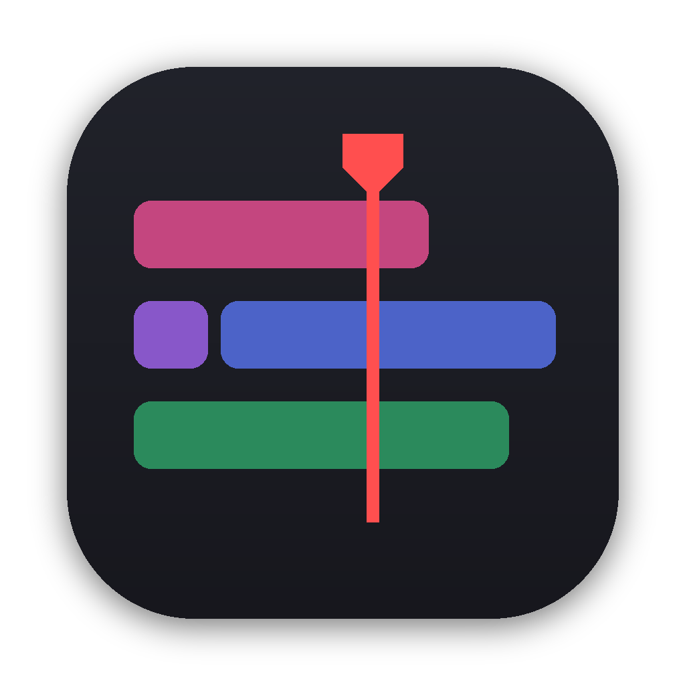
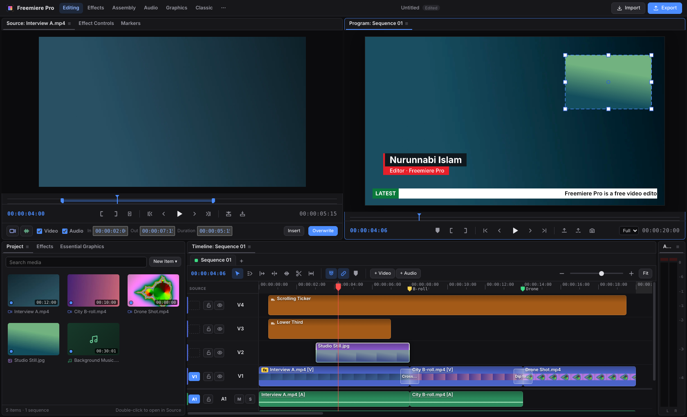
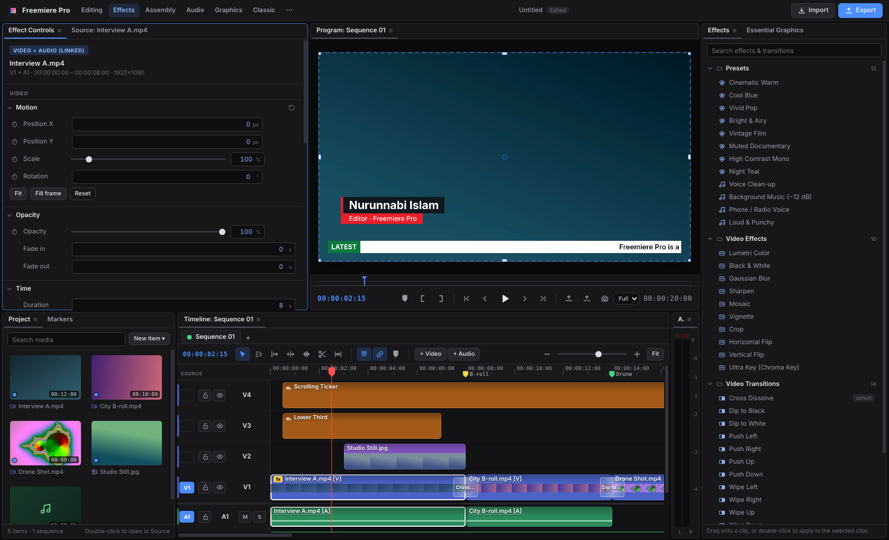

<div align="center">



# Freemiere Pro

**A free, Premiere-style video editor for macOS.**

Dockable panels, a real Source monitor, linked video and audio, effects, transitions,<br>
keyframes and broadcast graphics, rendered to H.264 with FFmpeg.

[](https://github.com/niruvai/freemiere-pro/releases/latest)
[](https://github.com/niruvai/freemiere-pro/releases)

[](LICENSE)

[**Download for Apple silicon**](https://github.com/niruvai/freemiere-pro/releases/latest/download/Freemiere-Pro-arm64.dmg) · [**Download for Intel**](https://github.com/niruvai/freemiere-pro/releases/latest/download/Freemiere-Pro-x64.dmg) · [All releases](https://github.com/niruvai/freemiere-pro/releases) · [বাংলা নির্দেশিকা](#বাংলা-নির্দেশিকা)

<br>



</div>

---

## Contents

- [Features](#features)
- [Installation](#installation)
- [Updating](#updating)
- [Getting started](#getting-started)
- [Keyboard shortcuts](#keyboard-shortcuts)
- [Building from source](#building-from-source)
- [Publishing a release](#publishing-a-release)
- [Project structure](#project-structure)
- [Known limitations](#known-limitations)
- [বাংলা নির্দেশিকা](#বাংলা-নির্দেশিকা)
- [License](#license)

## Features

### Workspace
- **Dockable panels.** Project, Source, Program, Effect Controls, Effects, Essential Graphics, Markers, Timeline and Audio Meters can each be dragged anywhere:
  - drop a tab in the middle of another panel to group them;
  - drop it on any edge to dock it beside that panel;
  - ⌘-drag it to float it as its own window.
- **Workspaces:** Editing, Effects, Assembly, Audio, Graphics and Classic. Each one remembers your layout until you choose **Reset to Saved Layout**.
- **Focused-panel shortcuts.** The panel you click gets a blue outline and receives the keyboard, just like Premiere. Press `` ` `` to maximize it.

### Source monitor
- Set In and Out with `I` / `O`, by dragging the range handles, or by typing a time (`2`, `1:30`, `00:00:05:00`).
- Choose whether to take the **video, the audio, or both**.
- Send the clip to the timeline with **Insert** (`,`) or **Overwrite** (`.`), or drag it there. **Drag Video Only** and **Drag Audio Only** handles take a single side.
- **Source patching** (the blue V1 / A1 indicators) decides which tracks Insert and Overwrite use.
- Drop a clip on the Program monitor to choose **Insert**, **Overwrite**, **Overlay** or **Append at End**.

### Timeline
- Multiple sequences, unlimited video and audio tracks, track lock, output, mute and solo.
- Tools: Selection (`V`), Track Select Forward (`A`), Ripple (`B`), Rolling (`N`), Rate Stretch (`R`), Razor (`C`), Slip (`Y`).
- **Linked clips.** Video and its sound are placed as linked V and A clips that move, trim and cut together.
  - Option-click selects one side; ⌘L links or unlinks.
  - A red badge shows how many frames a pair is out of sync.
- **Gaps:** click empty space to select a gap and press Delete to close it, or use **Sequence → Close Gaps**.
- Add Edit (⌘K), Ripple Trim to Playhead (Q / W), Lift / Extract, In/Out, markers, snapping, multi-select, ⌥-drag to duplicate, copy / paste / paste attributes, and 200 levels of undo.

### Effects & motion
- **Motion, Opacity, Volume and Pan** with keyframes (stopwatch, previous/next keyframe, linear, ease or hold).
- In the Program monitor:
  - drag inside a clip to move it;
  - drag a **handle to scale**, or **just outside a corner to rotate** (Shift snaps).
- **Video effects:** Lumetri Color (exposure, contrast, temperature, tint, saturation, faded film) with eight looks, Black & White, Gaussian Blur, Sharpen, Mosaic, Vignette, Crop, Flip and Ultra Key. Most effects accept **ellipse or rectangle masks** for blurring faces and number plates.
- **Adjustment layers** and color mattes.
- **Transitions:** Cross Dissolve, Dip to Black/White, Push, Wipe, Iris, Clock Wipe and Cross Zoom, plus Constant Power, Constant Gain and Exponential audio crossfades. ⌘D applies the default.

### Audio
- Live Web Audio mixing with volume up to 400 %, pan, EQ, high/low-pass, compressor, gain and DeNoise (applied on export).
- Presets: Voice Clean-up, Background Music (−12 dB), Phone / Radio Voice, Loud & Punchy.
- Master meters with peak hold and clip indicators.

### Graphics
- **Essential Graphics templates:** News Headline Bar, Scrolling Ticker, Lower Third, Breaking News, Live Bug and Caption Box.
- Every text, color, font and position is editable. Bangla and other complex scripts render correctly.
- Titles with any font, stroke, shadow and background box.

### Export
- H.264 MP4 or MOV with AAC audio, at any sequence size (1080p, 4K, vertical 9:16, square, 4:5…) and frame rate.
- Export the whole sequence or its In/Out range; **Export Frame** saves a PNG.
- Preview and export share one rendering model, so titles, graphics, effects, masks and transitions look the same in both.



## Installation

1. Download the DMG for your Mac from the [latest release](https://github.com/niruvai/freemiere-pro/releases/latest):

   | Your Mac | Download |
   |---|---|
   | Apple silicon (M1, M2, M3, M4…) | [Freemiere-Pro-arm64.dmg](https://github.com/niruvai/freemiere-pro/releases/latest/download/Freemiere-Pro-arm64.dmg) |
   | Intel | [Freemiere-Pro-x64.dmg](https://github.com/niruvai/freemiere-pro/releases/latest/download/Freemiere-Pro-x64.dmg) |

   Not sure which one you need? Open  menu → **About This Mac** and look at **Chip** or **Processor**.
2. Open the DMG and drag **Freemiere Pro** into **Applications**.
3. **First launch.** Freemiere Pro is not notarized by Apple, so macOS asks for confirmation once:
   - Control-click the app in Applications and choose **Open**, or
   - try to open it, then go to **System Settings → Privacy & Security** and click **Open Anyway**.

   If macOS reports that the app "is damaged", remove the download quarantine and open it again:

   ```bash
   xattr -cr "/Applications/Freemiere Pro.app"
   ```

FFmpeg is bundled with the app, so nothing else needs to be installed.

## Updating

Freemiere Pro checks for a new release when it starts and every six hours. You can also choose **Freemiere Pro → Check for Updates…**.

- **Install and Restart** downloads the build for your Mac, replaces the app in Applications and reopens it.
- **Download DMG** opens the download if you prefer to install by hand.
- **Skip this version** stops reminders until the next release.

Automatic installation needs the app to be in a folder you can write to, such as Applications, and not running from the DMG.

## Getting started

1. **Import** media (⌘I) or drop files onto the window.
2. Double-click a clip in **Project** to open it in **Source**. Mark In/Out and pick Video and/or Audio.
3. Press `.` to overwrite at the playhead or `,` to insert, or drag the picture onto a track.
4. Trim with the tools, add effects from **Effects**, and graphics from **Essential Graphics**.
5. Select a clip to adjust it in **Effect Controls**, or move, scale and rotate it directly in **Program**.
6. **Export** (⌘M) and choose the size, frame rate and quality.

Projects are saved as `.fpproj` files. Media stays where it is on disk.

## Keyboard shortcuts

| Action | Shortcut |
|---|---|
| Play / Stop · Shuttle | Space · J K L |
| Step one / five frames | ← → · ⇧← ⇧→ |
| Previous / next edit point | ↑ ↓ |
| Tools | V A B N R C Y |
| Add Edit · to all tracks | ⌘K · ⇧⌘K |
| Ripple trim previous / next edit to playhead | Q · W |
| Clear · Ripple Delete (clips or a selected gap) | ⌫ · ⇧⌫ |
| Default video / audio transition | ⌘D · ⇧⌘D |
| Link / Unlink · select one side | ⌘L · ⌥-click |
| Mark In / Out · go to · clear | I O · ⇧I ⇧O · ⌥X |
| Lift / Extract | ; · ' |
| Insert / Overwrite from Source | , · . |
| Insert while dragging | hold ⌘ on drop |
| Add marker · next / previous | M · ⇧M / ⌥⇧M |
| Snapping | S |
| Zoom in / out / to sequence | = · − · \ |
| Maximize panel | ` |
| Open panels | ⇧1 Project · ⇧2 Source · ⇧3 Timeline · ⇧4 Program · ⇧5 Effect Controls · ⇧6 Meters · ⇧7 Effects |
| New sequence / project | ⌘N · ⌥⌘N |
| Import · Export media · Export frame | ⌘I · ⌘M · ⇧⌘E |
| Undo / Redo | ⌘Z · ⇧⌘Z |

The full list is in **Help → Keyboard Shortcuts**.

## Building from source

Requirements: macOS 11 or later, [Node.js](https://nodejs.org) 18 or later, and Git (`xcode-select --install`).

```bash
git clone https://github.com/niruvai/freemiere-pro.git
cd freemiere-pro
npm install
npm start          # run from source
npm run dist       # build dist/Freemiere-Pro-<arch>.dmg and .zip
```

`npm start` and `npm run dist` first make sure the Electron runtime and FFmpeg binaries are installed. Newer npm versions can skip dependency install scripts; this check handles that case. Run `npm run setup` to do it on its own.

## Publishing a release

Releases are built by [GitHub Actions](.github/workflows/release.yml) on macOS runners, for both Apple silicon and Intel.

1. Bump `version` in `package.json` and add a section for it to [CHANGELOG.md](CHANGELOG.md).
2. Commit, then tag and push:

   ```bash
   git tag v2.3.0
   git push origin main v2.3.0
   ```

3. The workflow builds `Freemiere-Pro-arm64` and `Freemiere-Pro-x64` (DMG + ZIP) and publishes a GitHub Release. The release notes come from the changelog. Installed copies of the app pick the new release up automatically.

## Project structure

```
build/                 App icon and the packaging hook (ad-hoc code signing)
scripts/setup.js       Makes sure Electron and FFmpeg are installed
src/main.js            Window, menus, dialogs, media server, FFmpeg jobs
src/updater.js         Update checks and self-install from GitHub Releases
src/export.js          Sequence → a single FFmpeg filter graph
src/shared/defs.js     Effects, transitions, looks, graphics templates, keyframe maths
src/renderer/
  index.html           Panels and dialogs
  js/core.js           Project model, sequences, selection, linking, gaps, undo
  js/render.js         Titles, graphics, effects, masks and transitions
  js/preview.js        Playback, compositor, on-screen transform handles
  js/audio.js          Web Audio engine and meters
  js/timeline.js       Timeline and editing tools
  js/inspector.js      Effect Controls
  js/panels.js         Source monitor, Effects, Essential Graphics, Markers
  js/dock.js           Panel docking and workspaces
  js/dnd.js            In-app drag and drop
  js/app.js            Commands, shortcuts, import, save/open, export dialog
```

## Known limitations

- The app is not signed with an Apple Developer ID, so macOS asks for confirmation on first launch.
- Effect parameters such as blur amount can't be keyframed yet. Motion, opacity, volume and pan can.
- Not yet supported: nested sequences, multicam, LUT files and subtitle (.srt) import.
- DeNoise is heard in the exported file, not in live preview.
- Long sequences with many transitions and effects take longer to export.

Found a bug or have an idea? [Open an issue](https://github.com/niruvai/freemiere-pro/issues).

## বাংলা নির্দেশিকা

**ইনস্টল**
1. ওপরের লিংক থেকে আপনার ম্যাকের DMG নামান: Apple M1/M2/M3/M4 হলে **arm64**, Intel হলে **x64**।
2. DMG খুলে **Freemiere Pro**-কে **Applications**-এ টেনে দিন।
3. প্রথমবার খুলতে অ্যাপে রাইট-ক্লিক করে **Open** চাপুন। অথবা **System Settings → Privacy & Security → Open Anyway** চাপুন। "damaged" লেখা এলে Terminal-এ চালান: `xattr -cr "/Applications/Freemiere Pro.app"`

**আপডেট**
নতুন ভার্সন এলে অ্যাপ নিজেই জানাবে। **Install and Restart** চাপলে নিজে থেকে আপডেট হয়ে আবার খুলবে। হাতে দেখতে চাইলে **Freemiere Pro → Check for Updates…**।

**মূল কাজ**
- **প্যানেল সাজানো:** ট্যাব টেনে অন্য প্যানেলের মাঝে ছাড়লে একসাথে ট্যাব হয়। কিনারায় ছাড়লে পাশে বসে। ⌘ চেপে টানলে আলাদা ভাসমান উইন্ডো হয়।
- **Source থেকে কাটা:**
  - Project-এ ডাবল-ক্লিক করুন, তারপর `I` / `O` চেপে বা In/Out ঘরে সময় লিখে অংশ ঠিক করুন।
  - **Video / Audio** টিক দিয়ে বেছে নিন কী নেবেন।
  - **Overwrite** (`.`) বা **Insert** (`,`) চাপুন, অথবা ছবিটা টেনে টাইমলাইনে দিন।
- **ফাঁকা জায়গা মোছা:** দুই ক্লিপের মাঝের ফাঁকা জায়গায় ক্লিক করে Delete চাপুন। অডিও সহ পরের ক্লিপগুলো সরে এসে ফাঁক বন্ধ হয়। সব ফাঁক একসাথে মুছতে **Sequence → Close Gaps**।
- **স্কেল ও ঘোরানো:** Program মনিটরে ক্লিপের কোণার বা পাশের সাদা চৌকো টানলে ছোট-বড় হয়। কোণার একটু বাইরে থেকে টানলে ঘোরে। Shift চেপে রাখলে ধাপে ধাপে মাপ মেলে।
- **ভিডিও-অডিও জোড়া:** ক্লিক করলে দুটোই সিলেক্ট হয়। ⌥-ক্লিকে শুধু একটা। ⌘L দিয়ে জোড়া খোলা বা লাগানো যায়।

## License

[MIT](LICENSE) © 2026 Nurunnabi Islam. FFmpeg is bundled under the LGPL/GPL via [ffmpeg-static](https://github.com/eugeneware/ffmpeg-static).
